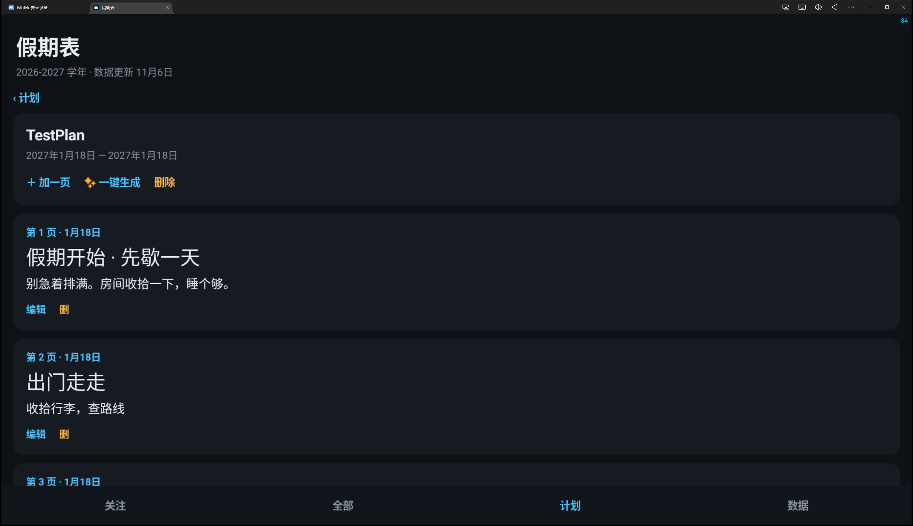
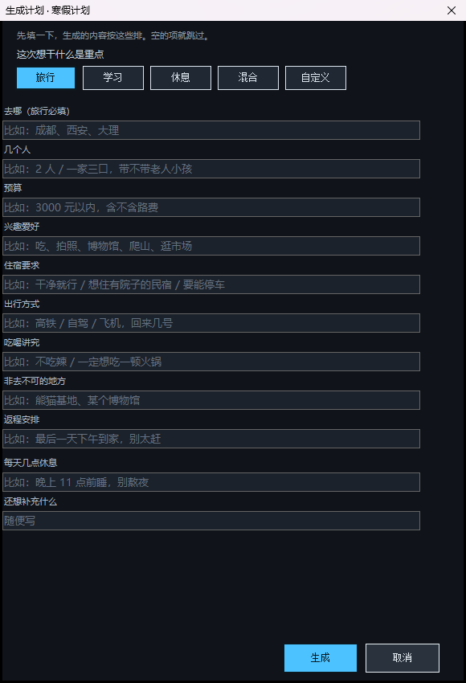

# 假期表

全国学校假期查询。按地区或学校查寒假、暑假、法定节假日，能把自己关心的那几个加进关注列表看倒计时。

**两个规矩：**
1. **每条假期都带出处** —— 原文标题、链接、发布日期、我核对它的日期。
2. **查不到就写「待补」** —— 不拿别处的估算填进来，填错了比空着更糟。

**数据会自己更新** —— 三端启动时都会在后台查一次远端，有新版就静默换上，不用点任何按钮。

---

## 四个东西

| 是什么 | 在哪 | 怎么用 |
| --- | --- | --- |
| Windows 桌面版 | `desktop/build/JiaQi.exe` | 双击运行，单文件，无需安装 |
| Android 应用 | `app/build/jiaqi.apk` | 装到手机上 |
| 网页版 | `启动网页版.bat` | 双击，浏览器自动打开 |
| 数据管道 | `tools/` | 抓取 → 构建 → 发布 |

三个端用同一份数据，界面和信息结构一致。

---

## 数据怎么更新

### 平时：什么都不用做

三端启动时都会在后台查一次 GitHub，有新版就静默换上。同一天只查一次，连不上就继续用本地的，不弹错误。

exe 更新成功时标题栏会短暂显示「数据已更新到 2026-11-06」。

### 要改数据的时候

```bash
python tools/build_data.py    # 重新生成 + 自检
python tools/publish.py       # 推到 GitHub，三端下次启动自动拉
```

或者双击 **`更新数据.bat`**：构建、发布、重新打包 exe 和 apk 一次跑完。

### 手动兜底

「数据」页填一个 JSON 地址 + 点「检查更新」。地址可以是任何能访问到 `holidays.json` 的地方，不一定是 GitHub。

### 两个坑

1. **GitHub raw 有 CDN 缓存**，刚发布的内容几分钟内可能还拉到旧版。三端的请求带了时间戳参数（`?t=毫秒`）绕缓存，但不保证每次都灵——真拉到旧版，等几分钟重开一次。
2. **别用字节数判断有没有推上去**。Git 会把 CRLF 转成 LF，`publish.py` 的克隆里是 187323 字节，GitHub 上变成 180544，差的 6779 正好是行数。**内容是一致的**，JSON 解析出来完全相同。

## 除了寒暑假，还查什么

「假期表」现在算的是**完整的休息日**，不只是寒暑假：

| 类型 | 来源 | 覆盖 |
| --- | --- | --- |
| 寒假 / 暑假 | 各省级/市级校历 | 21 个省 |
| **秋假 / 春假** | 各市教育局公布 | 浙江 11 市、山东 12 市（2026 秋假，具体日期） |
| 法定节假日 | 国务院办公厅 | 全国 8 个（含儿童节） |
| **双休** | 周末规则 | 全国，周六日；高中/寄宿制可能例外 |

打开任意城市，第一张卡片就是「**接下来 14 天**」：哪个格子是橙色（放假）、蓝色（春秋假）、灰色（周末）、深色（上课），一眼看完。今天那格底下有一条青色线。

上面还写着「休 N 天」。

> 周末按周六日算。**高中、寄宿制学校、毕业班可能周六上课或安排月假**，这块没有全国统一数据，卡片上写明了「以学校通知为准」。


### 覆盖：31 / 31 个省级行政区

- **21 个有数据**：北京、上海、重庆、天津、广东（21市）、四川（12市州）、江苏、浙江（杭州）、山东（济南）、江西、福建（福州/厦门）、湖北（武汉）、湖南（长沙）、海南、陕西（西安）、安徽（芜湖）、贵州、内蒙古（包头）、广西（贵港/玉林）、云南（省级口径）

- **10 个待补**：河北、山西、吉林、黑龙江、河南、西藏、甘肃、青海、宁夏、新疆

  这些省份 2026-2027 学年的中小学寒假安排，公开渠道查不到教育部门的正式文件。可能是还没发布，也可能是发在内部系统或本地媒体上没被收录。**App 里点进去会明确写「数据待补」并说明原因，不会拿估算糊弄。**

- **7 个法定节假日**（国办发明电〔2026〕10号，2026-11-05 发布）
- **14 所高校**校历（甘肃兰州 7 所、吉林长春 7 所）

### 每条数据带什么

| 字段 | 说明 |
| --- | --- |
| `source.title / url` | 原文标题和链接 |
| `source.published` | 官方发布日期 |
| `source.fetchedAt` | 我抓下来核对的时间 |
| `source.grade` | `official` 官方 / `media` 媒体转载 / `aggregate` 第三方汇总 |
| `endDerived` | 结束日期是从开学日倒推的，不是原文写的 |

---

## 界面

底部三个页签：

- **关注** —— 我盯的学校/地区，每张卡显示下一个假期和倒计时。右键取消。
- **全部** —— 全国法定节假日 / 高校校历 / 31 个省级行政区（没数据的标「待补」）。
- **数据** —— 数据版本、覆盖范围、全部来源链接、手动更新入口。

### 中小学按地区、大学按学校

中小学假期不是学校自己定的，是所属区县教育局按上级校历统一执行，所以按**地区**关注。
大学是每所学校自己定，同城不同校都能差一周，所以按**学校**关注。

---

## 三条命令

```bash
PY=python

# 1. 抓：按登记的来源 URL 抓原文，抽日期，和库里逐条比对
$PY tools/fetch_sources.py      # → data/fetch_report.json

# 2. 建：改了原始条目后重新生成 + 自检
$PY tools/build_data.py         # → data/holidays.json

# 3. 发：推到 GitHub，三端下次启动自动换上
$PY tools/publish.py

# 打包
bash app/build.sh               # Android
desktop/build.bat               # Windows exe
```

最近一次抓取：**11 个来源全部成功，核对 236 条，开始日缺失 0**。

---

## 已知限制

- 学校实际放假可能跟地区差几天（民办校、寄宿制、高三补课）。以学校通知为准。
- 中小学没有逐校数据，全国二十多万所，也没有统一发布渠道。
- **春秋假一个都没收**。2026 年已有 14 省全省推行，这是比寒暑假更碎的新变量，也是最大的缺口。
- 10 个省的官方校历还没查到，App 里标「待补」。
- APK 已在 **MuMu 模拟器（Android 12）** 上装过、点过：启动、全部页、城市列表、搜索、往年数据都正常。真机（不同屏幕比例/字体）未测。

---

## 目录

```
jiaqi/
├── desktop/              Windows 桌面版（WinForms，用系统自带 csc.exe 编译）
│   ├── Model.cs
│   ├── App.cs
│   ├── build.bat
│   └── build/JiaQi.exe
├── app/                  Android 应用（aapt2+javac+d8 直接打包）
│   ├── src/com/xiaojing/jiaqi/
│   ├── assets/holidays.json
│   └── build/jiaqi.apk
├── web/index.html        网页版（单文件，无依赖）
├── data/holidays.json    数据本体
├── tools/
│   ├── fetch_sources.py  抓取 + 比对
│   ├── build_data.py     构建 + 自检（原始条目都在里面）
│   └── publish.py        发布到 GitHub
├── docs/数据源.md         来源登记表 + 待补清单
└── 启动网页版.bat
```

---

## 省内差异怎么处理

**每个省都展开成完整的地级行政区列表**，一共 353 个市/州/地区/盟。

点进一个省，看到的是这个省**所有**地级单位：

- 有的标「小学 · 初中 · 高中」—— 已收录该市校历
- 有的标「未收录」—— 这个市的数据还没拿到
- 有的标「春秋假」—— 只有春秋假数据（比如浙江、山东的部分城市）

顶部会写清楚：「湖北省共 13 个地级行政区，其中 1 个已收录数据，其余显示「未收录」」。

**这样不会出现「陕西省只有西安」这种误解。** 陕西 10 个市全在列表里，只是另外 9 个还没数据。

### 省级口径

江西、海南、贵州、云南四个省，目前只有省级汇总口径（没有逐市数据）。这四省的城市点进去会显示：

> 省级口径 · 该市未单独发布，按全省安排

数据本身也标着「省级汇总口径」和来源，不会让人误以为是这个市自己发布的。

### 待补的 10 个省

河北、山西、吉林、黑龙江、河南、西藏、甘肃、青海、宁夏、新疆——同样列出全部城市，点进去写明为什么空着。

---

## 「未收录」到底是什么意思

分三种情况，界面上分开标：

**1. 今年还没公布** —— 河北、山西、吉林、黑龙江、河南、西藏、甘肃、青海、宁夏、新疆。

这些省 2026-2027 学年的校历确实还没发。查过省教育厅官网、本地宝各城市分站、光明网/央广网转载，都只到 2025-2026 学年。河北去年的安排是 **2026 年 1 月 27 日**才整理出来的。

**2. 只有往年数据** —— 河北 11 个市都挂了 2026 年的放假时间，标成「2026 年（去年）的安排」。

比如唐山市：义务教育 2026-01-24、高中 2026-02-07、春季开学 2026-03-01。石家庄是 02-04 / 02-11 / 03-05。**同一个省差了 11 天**——这就是省内差异。

数据来源是[河北初中升学网](http://www.zzwhb.com/cjwt/6140.html)（2026-01-27，aggregate 级）。

**3. 省级口径** —— 江西、海南、贵州、云南。只有省级汇总，没有逐市数据，界面上标「省级口径 · 该市未单独发布」。

### 为什么不全补成「参考值」

因为差 10 天不是小事。家长按错的日期订票、请假，比看到「未收录」更糟。

---

## 搜索

「全部」页顶部有搜索框，**什么都搜**：

| 输入 | 结果 |
|---|---|
| 石家庄 | 石家庄市（河北省）· 2026 年 2 月 4 日放假 |
| 山东 | 山东省 · 16 个地级行政区 |
| 兰州 | 兰州市 + 兰州大学、西北师大、兰理工… 7 所高校 |
| 广州 | 广州市 · 小学 · 初中 · 高中 |

城市、省份、高校三类结果混在一个列表里，点哪条跳哪条。

实现细节：exe 和 APK 是输完按回车（/搜索键）才执行，Web 是边打边出。

---

## 自己加抓取网站（exe 端）

「数据」页底部有「抓取网站」：能加、能改、能删、能抓。

**内置 31 个省级教育主管部门**（首次打开自动填入）。这些是我逐个探测过的，28 个当时可达，3 个（江苏、西藏、甘肃）没连上。

### 怎么抓的

1. 你贴的地址如果是**具体的文章页** → 直接抓那一页，抽日期
2. 如果只贴主站 → 去站内翻「政务公开 / 通知公告」一类栏目，再找含「校历 / 放假 / 日程」的链接
3. 从页面正文里抽「2027年1月18日」这类日期，看**日期后面 40 字内**有没有「放寒假 / 放暑假 / 开学」
4. 同一个网站 60 秒内只抓一次

### 实测结果

- **贴具体文章页有效**：拿北京教委那份校历通知（`t20260417_4588623.html`）测，抽出 9 条——寒假 2027-01-18 / 2027-01-25、暑假 2027-07-06 / 2027-07-13、开学 2026-09-01 / 2027-02-22
- **只贴主站经常抓不到**：北京那次的栏目页第一屏没有校历链接，返回「看了 4 个栏目、0 个页面」

所以：**想真抓到东西，贴具体那篇文章的网址**。主站只作为「试试看」。

### 没做的

- **robots.txt 没读**。现在只靠 60 秒节流控制频率。
- **APK 端还没这个功能**，只有 exe 有。
- 抓到的日期只是列出来给你看，**没有自动合并进 holidays.json** —— 数据入库仍然走 `build_data.py`，因为机器抽的会带噪声（实测 9 条里有 2 条是「至2月21日」这种结束日期被误读）。

---

## 假期计划（exe 端）

「计划」页：给一个假期建一份计划，像 PPT 那样一页页排。

### 能做什么

| 功能 | 说明 |
|---|---|
| 建计划 | 名字 + 假期区间 |
| **编辑页面** | 16:9 画布，往上放文字/图片/视频/音乐，拖到想要的位置 |
| **一键生成** | 按假期长度和风格（学习/旅行/休息/混合）自动排页 |
| 挂媒体 | 图片直接显示；视频/音频点开用 **内嵌播放器**（Windows Media Player 控件） |
| 格式 | 图片 23 种、视频 24 种、音频 25 种（含 heic/avif/webp/svg、mkv/webm/rmvb、flac/opus/ape 等） |
| 提醒 | 到点弹托盘通知 + 响铃，每天一次，可关 |
| **铃声截取** | 上传本地音频，可设「从第 X 秒到第 Y 秒」，也能截成新文件 |

### 实测

- **编辑器**：1180×780 窗口，左侧页列表、顶部工具条、中间画布 ✅
- **生成**：混合 8 页（寒假开始 → 中间旅行/学习 → 收心）、学习型 5 页、旅行型 8 页 ✅
- **铃声截取**：拿 `C:\Windows\Media\Alarm01.wav`（5.57s / 22050Hz / 2ch / 16bit）截 0.5–1.5s，
  出来 88244 字节 = 1.00s × 22050 × 2 × 2 + 44 字节头 ✅
- **内嵌播放**：WMP ActiveX 已接（`WMPlayer.OCX`），支持从某秒开始、到某秒停

### 限制

- **截取只支持 WAV（PCM）**。mp3/m4a/flac 在纯 .NET 里解不了码，只能整段播。
- **视频/音频不能「生成」**——它只能挂你硬盘上已有的文件，不会凭空造。
- 媒体记的是**本地路径**，不是复制进应用。换电脑/删文件就找不到。
- **APK 和网页版还没有计划功能**。

### 网页版也有计划了

`web/index.html` 加了第四个 tab「计划」：

- 建计划、加页、编辑（文字 / 图片）
- 一键生成（学习 / 旅行 / 休息 / 混合）
- 存在浏览器 localStorage 里，**换设备不同步**

**网页版的限制**（跟桌面版不一样的地方）：

- 图片走 base64 存进 localStorage，**单张超过 1.5MB 会存不下**（浏览器一般只给 5MB）
- 视频/音频**不能内嵌播放**，只显示文件名
- 没有提醒（浏览器关了就不响）
- 没有拖拽排版，只有上下排

### 提醒实测

```
提醒时间: 01:54 / 计划区间: 2026-11-06 — 2026-11-06
触发次数: 1
触发计划: 测试计划
再查一次后触发次数: 1     ← 去重正确，不会重复响
```

---

### APK 也有计划了

底部 tab 变成四个：关注 / 全部 / **计划** / 数据。



- 建计划、加页、编辑（文字 / 从相册选图）
- 一键生成（学习 / 旅行 / 休息 / 混合）
- 存在手机本地（SharedPreferences），换手机不同步

**提醒**（`ReminderReceiver.java`）：

| 能力 | 实现 |
|---|---|
| 定时 | `AlarmManager.setAndAllowWhileIdle` + `PendingIntent` |
| 通知栏 | `NotificationChannel`（IMPORTANCE_HIGH）+ BigTextStyle |
| 铃声 | `RingtoneManager`——可指定本地音频路径，没指定就用系统通知音 |
| 振动 | `Vibrator`，600ms，可在计划里关 |
| 权限 | POST_NOTIFICATIONS / VIBRATE / SCHEDULE_EXACT_ALARM，Android 13+ 会弹窗要 |

**实测过的**（模拟器 Android 12）：

- 计划页正常显示 ✅
- 新建计划（输入框、日期解析）✅
- 一键生成 → 选"混合" → 生成 3 页，每页有日期/标题/正文 ✅
- 页面编辑、删除 ✅

**没实测的**：

- **闹钟到点真的响**——代码写了，但没等到点验证（要改系统时间或等一分钟，这轮没做）
- 从相册选图（`ACTION_GET_CONTENT`）没点过
- 视频/音频**在 APK 上只能显示文件名，不能播**（没接 MediaPlayer / VideoView）

### 三端能力对照

| | exe | 网页 | APK |
|---|---|---|---|
| 建计划 / 加页 | ✅ | ✅ | ✅ |
| 文字编辑 | ✅ | ✅ | ✅ |
| 图片 | ✅ 任意大小 | ⚠️ ≤1.5MB（base64） | ✅ 存进私有目录 |
| 视频/音频 | ✅ 内嵌播放 | ❌ 只显示名字 | ❌ 只显示名字 |
| 排版 | ✅ 画布拖拽 | ❌ 竖排 | ❌ 竖排 |
| 一键生成 | ✅ | ✅ | ✅ |
| 提醒 | ✅ 已实测 | ❌ | ⚠️ 写了未实测 |
| 铃声截取 | ✅ 仅 WAV | ❌ | ❌ |

---

### 生成计划前先问清楚（exe 端）

点「✨ 一键生成」不再只问一个风格，先弹一张表。



**五个类型**：旅行 / 学习 / 休息 / 混合 / **自定义**

**旅行问什么**（11 项）：

| 字段 | 例子 |
|---|---|
| 去哪 | 成都、西安、大理 |
| 几个人 | 2 人 / 一家三口，带不带老人小孩 |
| 预算 | 3000 元以内，含不含路费 |
| 兴趣爱好 | 吃、拍照、博物馆、爬山、逛市场 |
| 住宿要求 | 干净就行 / 想住有院子的民宿 / 要能停车 |
| 出行方式 | 高铁 / 自驾 / 飞机，回来几号 |
| **吃喝讲究** | 不吃辣 / 一定想吃一顿火锅 |
| 非去不可的地方 | 熊猫基地、某个博物馆 |
| 返程安排 | 最后一天下午到家，别太赶 |
| 每天几点休息 | 晚上 11 点前睡，别熬夜 |
| 还想补充什么 | 随便写 |

**学习**问：主要学什么、每天学多久、目标、薄弱在哪、在哪学、学习之外想做什么
**休息**问：作息、想做的事、不想做的事、必须完成的事、平时喜欢什么

**实测输出**（成都 5 天，高铁，2 人，3000 元，吃+拍照，民宿）：

```
2027-01-18  出发 · 高铁去成都
            行李：证件、充电器、常用药
            同行：2 人
            住：有院子的民宿
            预算：3000 元以内
2027-01-20  成都 · 第 2 天
            找本地人吃的店，别去网红店排队
            吃：早饭吃本地早点，别在酒店吃
            晚上 11 点前睡
2027-01-22  成都 · 第 3 天
            挑一个高处等日落，带上相机
            吃：中午找家苍蝇馆子，看哪家人多进哪家
...
```

**「自定义」**：直接写，一行一页，`第一天：xxx` 这种冒号会被拆成标题+正文。

**它不是大模型写的**——是按表单条件拼的规则。想要真 AI 得接 API，现在没接。

---

### APK 对齐 exe（2026-11-06 2:15）

| 功能 | exe | APK 之前 | APK 现在 |
|---|---|---|---|
| 新建计划选日期 | 日历 | 手打 | **日历**（DatePickerDialog 两次） |
| 生成：类型 | 5 种 | 4 种 | **5 种**（含自定义） |
| 生成：字段 | 按类型切换 | 只有一个风格 | **按类型切换**（旅行 9 项 / 学习 5 项 / 休息 4 项 / 自定义 1 项） |
| 视频/音频 | 内嵌播放 | 只显示名字 | **点了调系统播放器** |
| 提醒 | 托盘 | 通知栏（未实测） | 同左 |

**实测（模拟器 Android 12）**：

- 新建计划：弹「下一步选开始日期」→ 日历选 11月20日 → 确定 → 弹结束日历（默认 +20 天 = 12月10日）→ 确定 → 计划建成，显示「2026年11月20日 — 2026年12月10日」✅
- 生成表单：默认显示旅行 9 个字段；点「学习」→ 字段立刻切换成「主要学什么 / 每天学多久 / 目标 / 薄弱在哪」✅

**还是不一样的地方**：

- APK 的页编辑是竖排（exe 是 16:9 画布拖拽）
- APK 没有铃声截取
- APK 的提醒**代码写了但没实测到点响**

---

### 主题配色（exe 端，2026-11-06 2:30）

数据页最下面加了「外观」：五套配色，点一下立刻换，存在 `theme.json`，下次打开还是那套。

| 主题 | 底色 | 主色 |
|---|---|---|
| 深海（默认） | `#0E1116` | `#4CC2FF` 亮蓝 |
| 暖褐 | `#17120E` | `#FF9E4A` 橙 |
| 森绿 | `#0B1410` | `#6FD98A` 青柠 |
| 暮紫 | `#121016` | `#B48CFF` 淡紫 |
| 白昼 | `#F5F6F8` | `#1F6FEB` 蓝（浅色，部分硬编码颜色没适配到） |

每套卡片右边有三个色块，不用点进去就知道长什么样。

**实测**：

- 手动把 `theme.json` 改成 `warm` 重启 → 整个界面变暖褐（背景、卡片、按钮、tab 全变）✅
- 点「深海」卡片 → `theme.json` 从 `{"id":"warm"}` 变成 `{"id":"deep"}`，界面当场切回深蓝 ✅

**修的一个 bug**：卡片里的 `Label` 会把点击吃掉，导致点字上没反应。加了 `BindClickAll` 把点击绑到所有子控件上——计划卡片、编辑页卡片、铃声卡片、主题卡片都补了。

### UI 收尾（2026-11-06 2:40）

改了三处间距，都按 4 的倍数走：

| 位置 | 之前 | 现在 |
|---|---|---|
| 内容区左右留白 | 14 | **16**（左右对称，`CardW = 宽 - 32`） |
| 卡片与卡片 | 10 | **12** |
| 页面顶部 | 4 | **8** |
| 卡片最小高度 | 自适应（一行字的卡片矮一截） | **72**，看着齐 |

字号层级没大动，还是三级：卡片标题 12–13 / 正文 10.5 / 说明 8.5。三级之间的比值 1.24 和 1.24，都在 1.2–1.35 这个能读出层级的区间里。

**没改的**：`Label` 的右键文案（比如「每天 09:00 提醒」）在窄卡片上还是会被截掉，没做换行或省略号。

---

## 下载 / 仓库

- 仓库：https://github.com/JMX-4869/jiaqi（私有）
- 下载：https://github.com/JMX-4869/jiaqi/releases/tag/v1.0.0

| 文件 | 大小 | 说明 |
|---|---|---|
| `JiaQi.exe` | 961 KB | Windows 桌面版，双击就能跑，不用装 .NET（系统自带） |
| `jiaqi.apk` | 103 KB | Android 安装包，最低 Android 5.0 |

## 怎么从源码构建

**exe**（需要 Windows 自带的 .NET Framework 4）：

```
cd desktop
build.bat
```

用的是 `C:\Windows\Microsoft.NET\Framework64\v4.0.30319\csc.exe`，只支持 C# 5 语法（没有字符串插值、没有 `?.`）。

**apk**（不用 Gradle，直接调 SDK 工具链）：

```
cd app
bash build.sh
```

流程：`aapt2 compile/link` → `javac` → `d8` → 塞 dex 进 apk → `zipalign` → `apksigner`。
需要 Android SDK（build-tools 34 / platform android-34）和 JDK 17。

**网页版**：直接开 `web/index.html`，或者双击 `启动网页版.bat`。

## 数据更新

数据在另一个仓库：`JMX-4869/jiaqi-data`。

```
tools\更新数据.bat
```

跑完会：重新生成 `data/holidays.json` → 推到数据仓库 → 重编 exe 和 apk。

三端启动时都会去 GitHub 拉最新的 `holidays.json`，拉不到就用内置那份。
